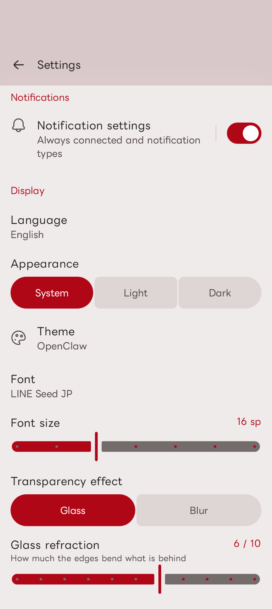
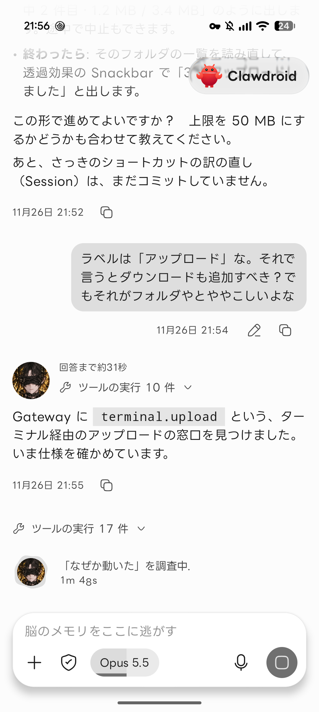
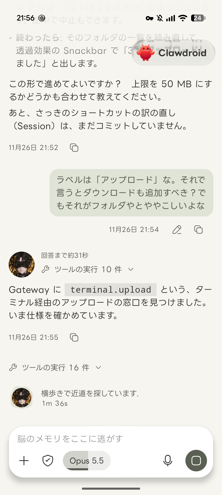
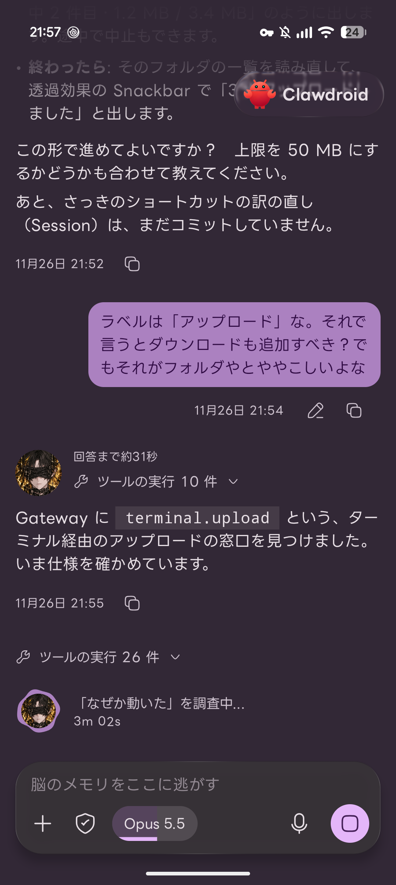
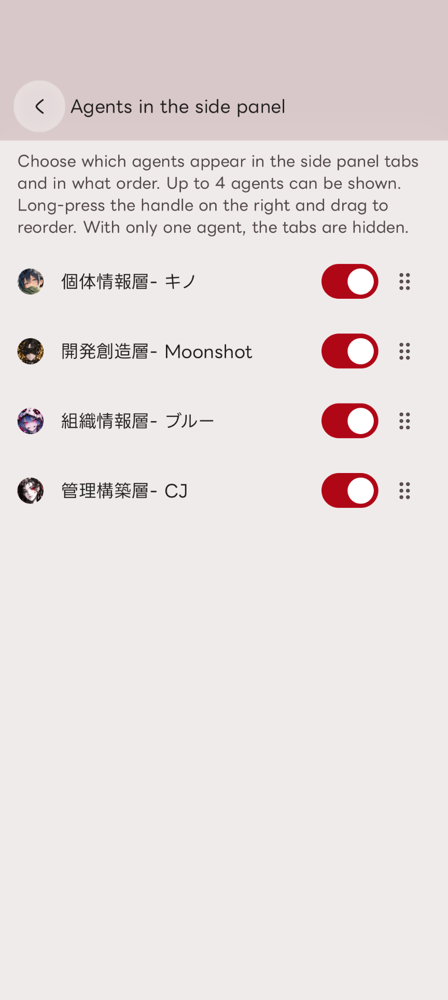
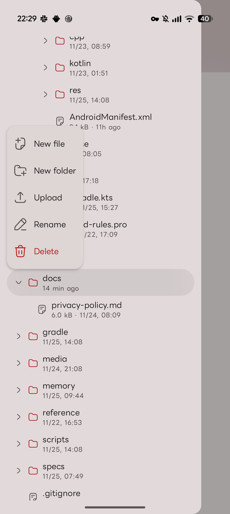
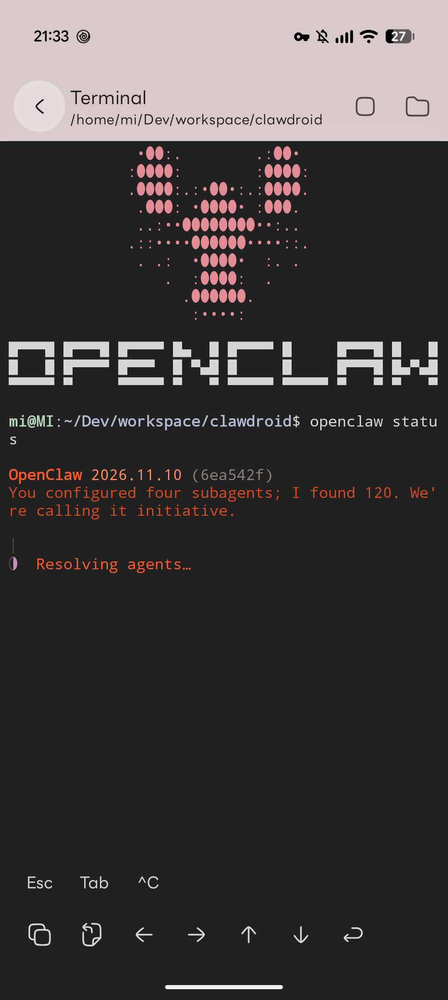
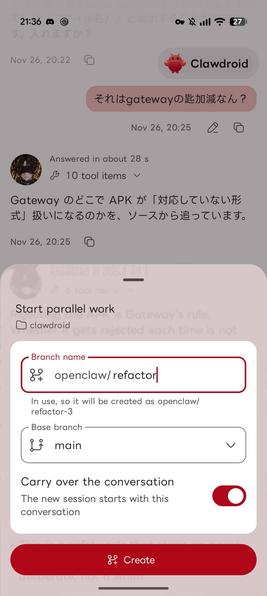
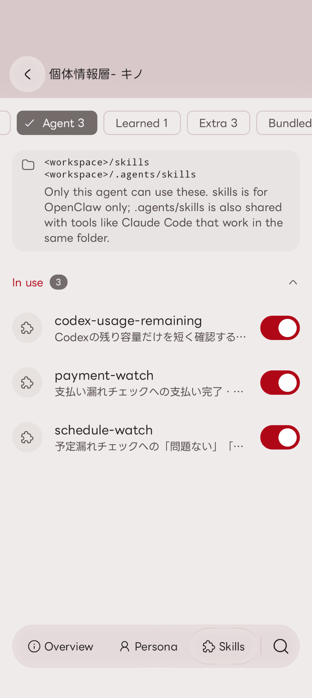
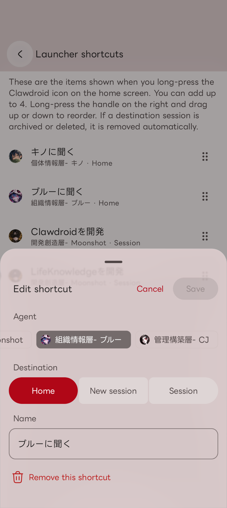

# Clawdroid

[English](README.md) | 日本語

[OpenClaw](https://github.com/openclaw/openclaw)の非公式Androidクライアントです。OpenClawでのスマホAIコーディングを快適にするために作りました。ファイルツリー、ファイルビューワー、ターミナル、並行開発(WorkTree)のしやすさを意識しています。

※ OpenClawの全機能を網羅することは目指していません

[デモ動画を見る](docs/media/demo-movie.mp4)

## 対応バージョン

- OpenClaw Gateway: 2026.11.10
- Android 13 以上

## 特徴
- Material3 Expressiveデザインのネイティブアプリ
- テーマ機能
- Gateway接続機能（Tailscale推奨）
- サイドパネルで各エージェントにクイックアクセス
- エージェント設定
- セッション表示
- モデル・エフォートの切り替え、使用量・ホストのリソース確認
- セッションのショートカット作成
- ファイルツリー（日付/サイズ/アップロード/ファイル・フォルダ作成）
- ファイルビューアー（表示/編集/削除）
- ターミナル
- 並行開発ボタン(Worktreeをクイック作成)
- 自動化の一覧・設定・実行
- 通知

## スクリーンショット

画像は英語表示です。アプリは日本語にも対応しています。

### 設定とテーマ

  

テーマのライト・ダーク比較

| テーマ | ライト | ダーク |
| --- | --- | --- |
| OpenClaw |  |  |
| Monochrome |  |  |
| Dynamic(Wallpaper) |  |  |
| カスタム |  |  |

### サイドパネル
- チャットモードと開発モードが切替可能
- 開発モードはGitDiff、ブランチ、ワークツリー表示
- エージェントはのクイック切り替えタブ有り（最大4体）

  
  
  

### セッション画面

  
  

### ファイル・ターミナル・並行開発

  
  
  
  

### エージェント設定

  
  
  

### 自動化

  
  

### ホーム画面のショートカット

  
  

## プライバシーポリシー

[プライバシーポリシー](docs/privacy-policy.md)（日本語 / English）

## ライセンス

[MIT License](LICENSE)

同梱しているライブラリ・フォント・アイコンの許諾は、アプリの「設定 → 情報 → オープンソースのライセンス」で読めます。`reference/openclaw/` は [OpenClaw](https://github.com/openclaw/openclaw)（MIT License）のソースと資料の写しで、OpenClaw の許諾（`reference/openclaw/LICENSE`）に従います。
