# SumahoClaw

[English](README.md) | 日本語

[OpenClaw](https://github.com/openclaw/openclaw)の非公式Androidクライアントです。OpenClawでのスマホAIコーディングを快適にするために作りました。ファイルツリー、ファイルビューワー、ターミナル、並行開発(WorkTree)のしやすさを意識しています。
> OpenClawの全機能を網羅することは目指していません

https://github.com/user-attachments/assets/460b1cbb-cf53-4374-a51c-96633a2e692d

## 対応バージョン

- OpenClaw Gateway: 2026.11.10
- Android 13 以上

## 特徴

Material3 Expressiveデザインのネイティブアプリです。

### テーマ

| テーマ名 | ライト | ダーク |
| --- | --- | --- |
| OpenClaw | 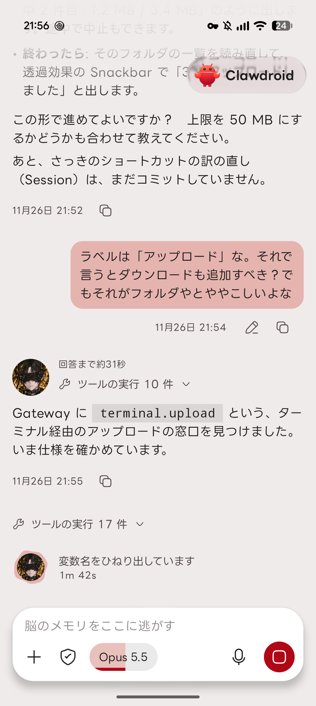 | 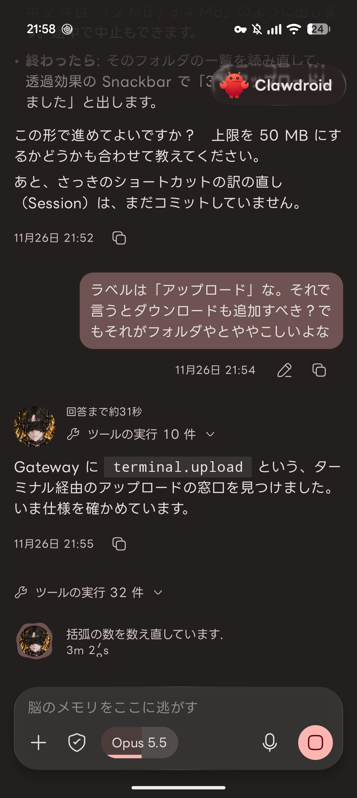 |
| Monochrome |  | 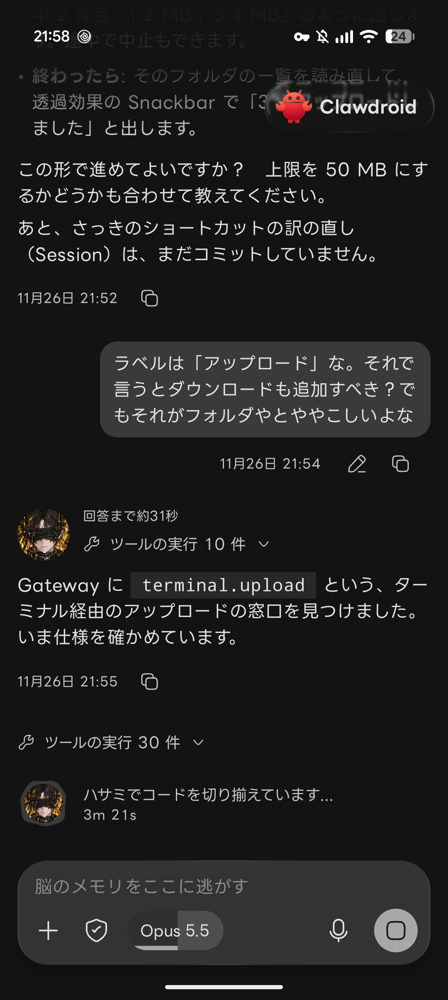 |
| Dynamic(Wallpaper) |  | 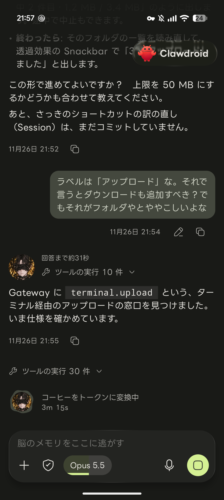 |
| カスタム | 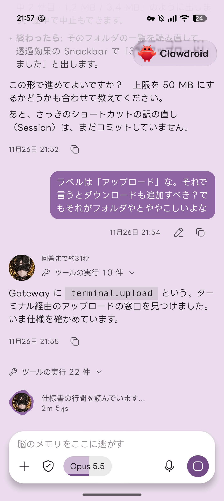 |  |

### 接続

Gateway接続はURLとトークンをいれてApprove。
Tailscale推奨です。

  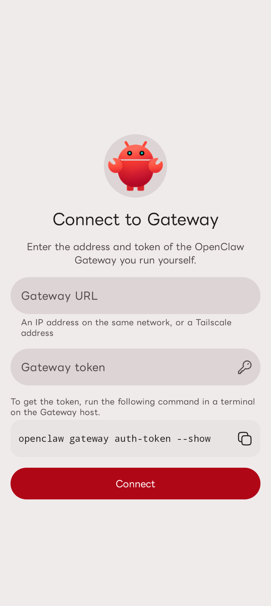

### サイドパネル

- チャットモードと開発モードを切り替えられます。
- 開発モードでは Git の差分・ブランチ・ワークツリーを確認できます。
- 最大4体のエージェントをタブですばやく切り替えられます。

  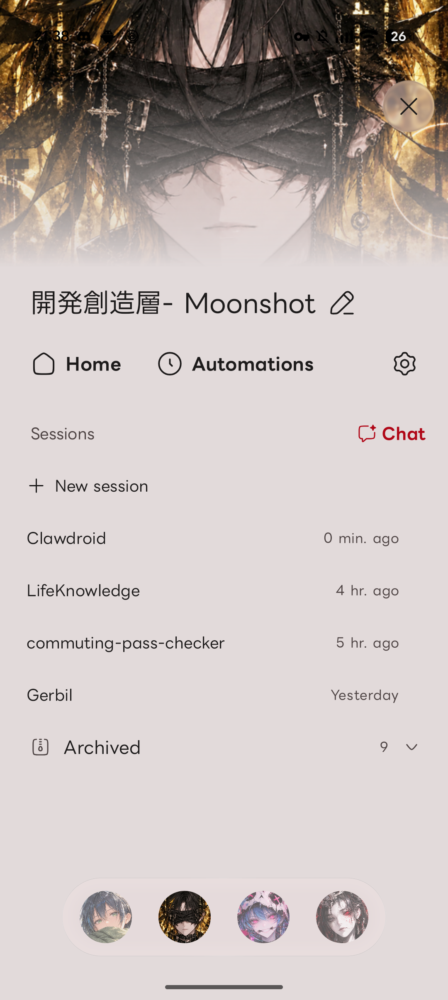
  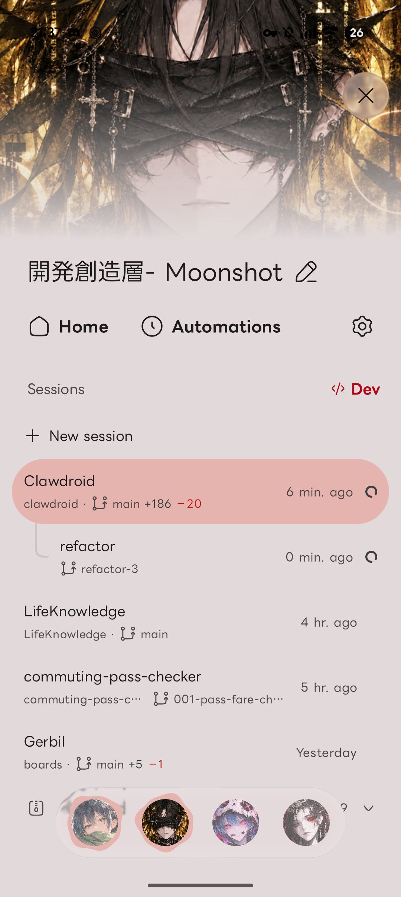
  

### セッション画面

- セッションの会話を表示しメニューから各機能へアクセスできます。
- モデル・エフォートを切り替え、使用量やホストのメモリ・ディスクも確認できます。

  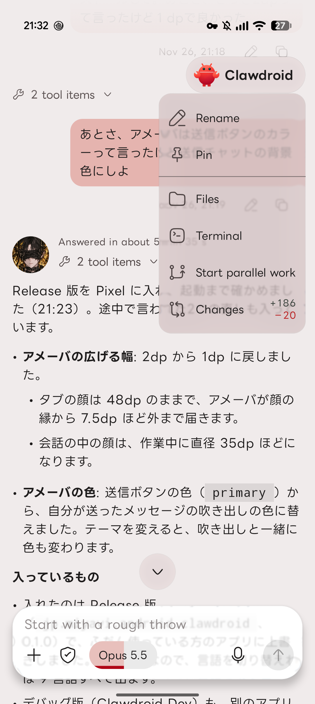
  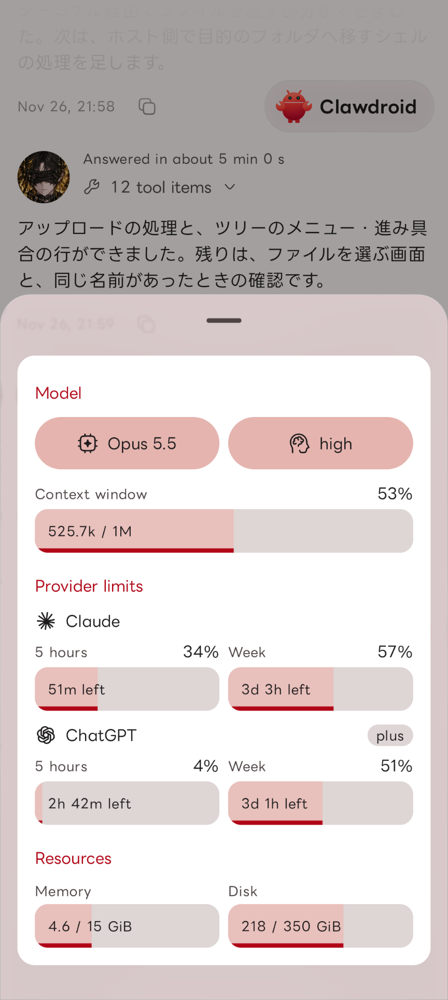

### ファイル・ターミナル・並行開発

- ファイルツリーで日付・サイズを確認し、アップロードやファイル・フォルダの作成ができます。
- ファイルビューアーでファイルを表示・編集・削除できます。
- ターミナルを利用できます。
- 並行開発ボタンからワークツリーをすばやく作成できます。

  
  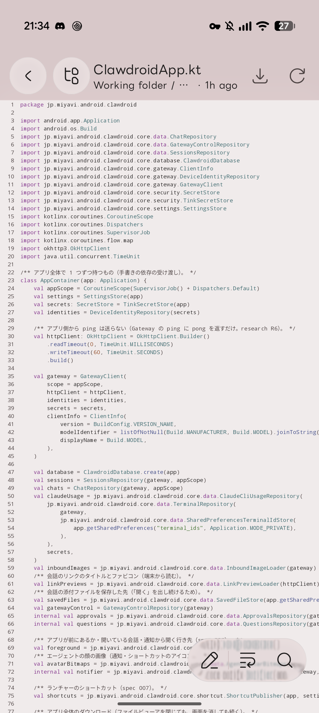
  
  

### エージェント設定

エージェントの概要、正確スキルを確認できます。

  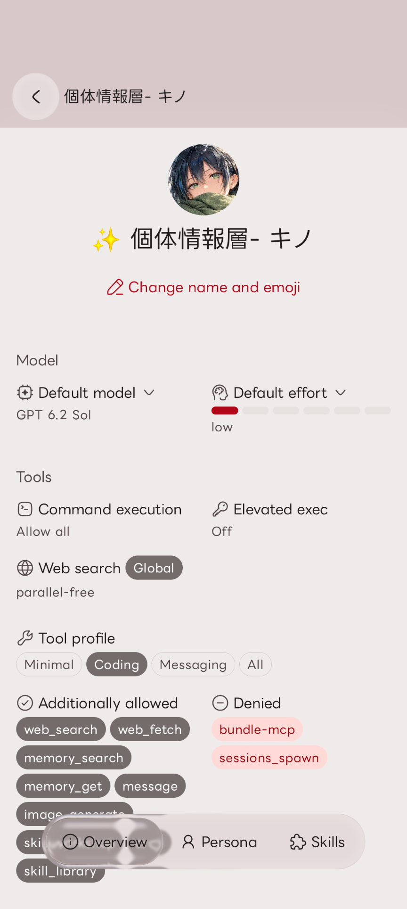
  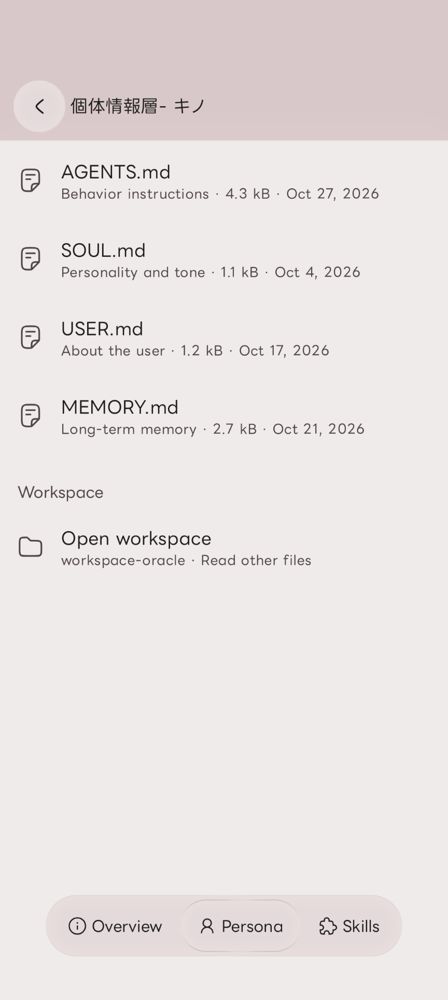
  

### 自動化

自動化の確認・変更・実行ができます。

  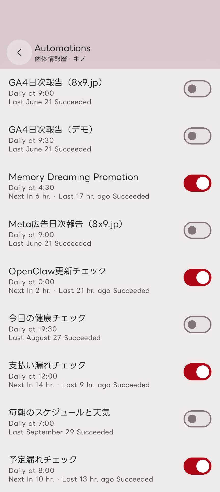
  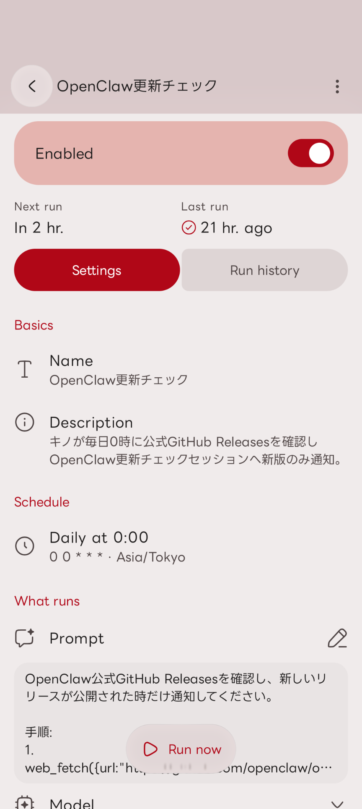

### ホーム画面のショートカット

エージェントやセッションを開くショートカットを作成・編集しホーム画面からすばやくアクセスできます。

  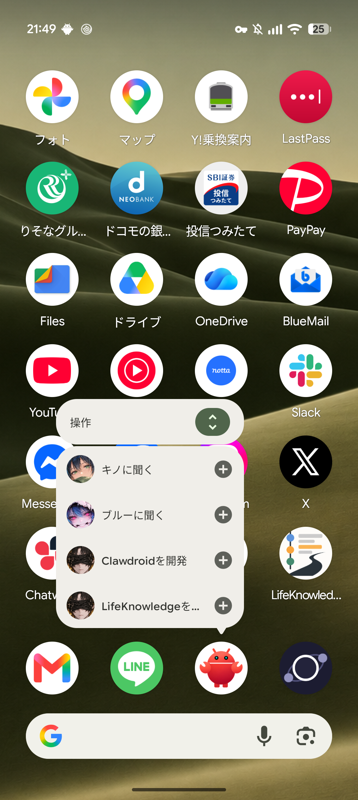
  

## プライバシーポリシー

[プライバシーポリシー](docs/privacy-policy.md)（日本語 / English）

## ライセンス

[MIT License](LICENSE)

同梱しているライブラリ・フォント・アイコンの許諾は、アプリの「設定 → 情報 → オープンソースのライセンス」で読めます。`reference/openclaw/` は [OpenClaw](https://github.com/openclaw/openclaw)（MIT License）のソースと資料の写しで、OpenClaw の許諾（`reference/openclaw/LICENSE`）に従います。
