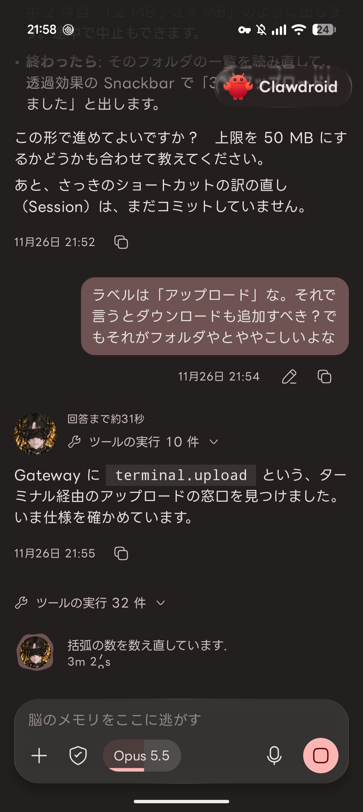
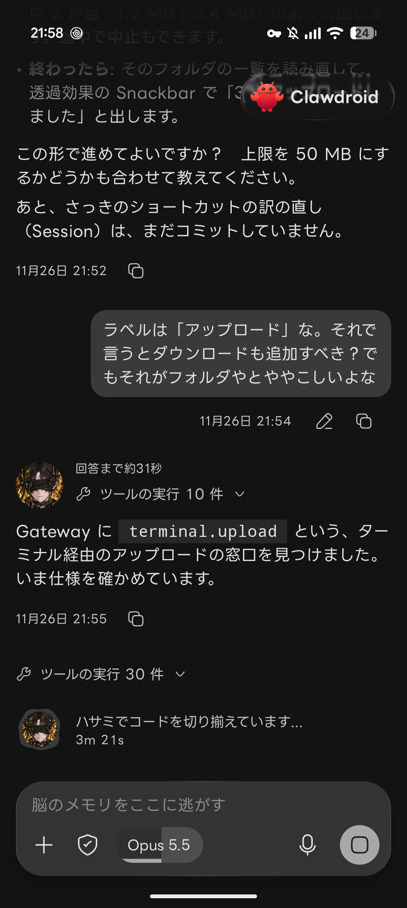
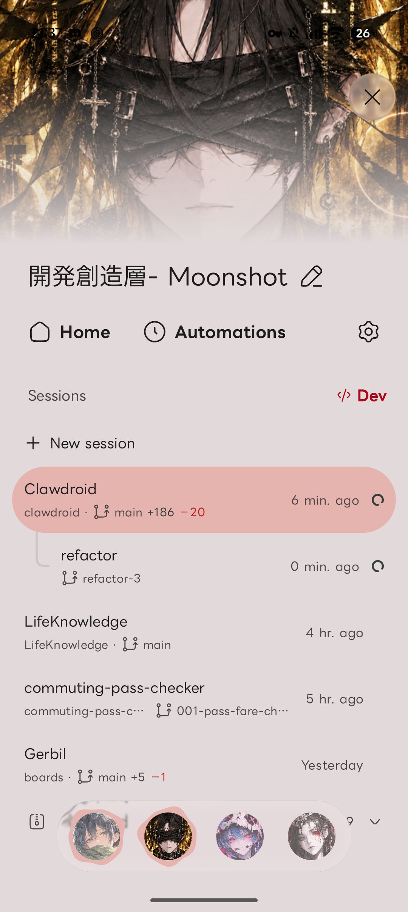
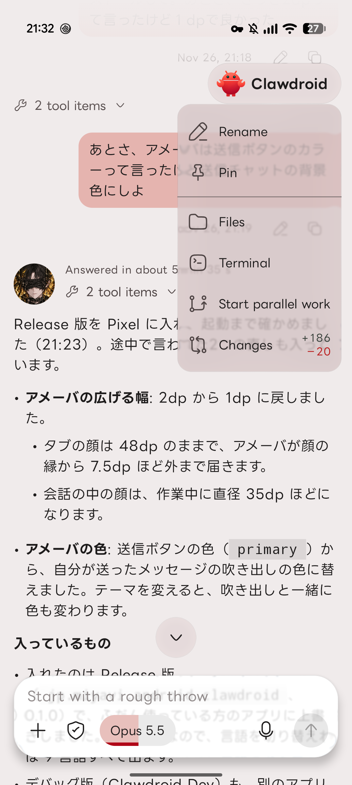
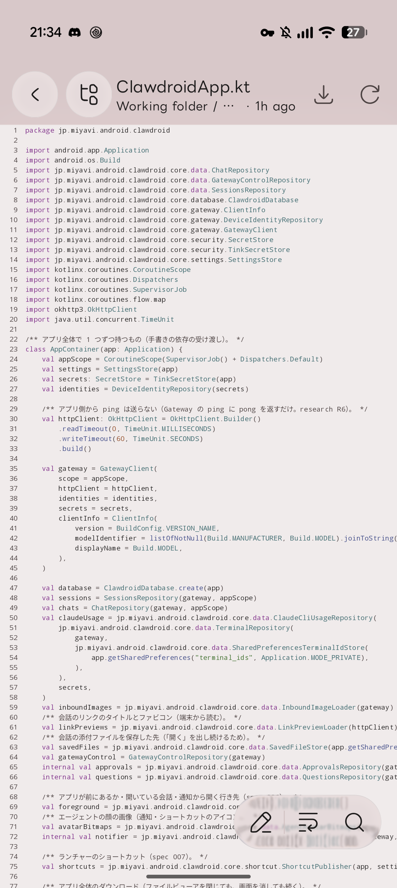
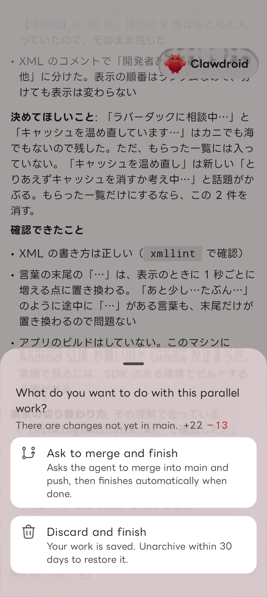
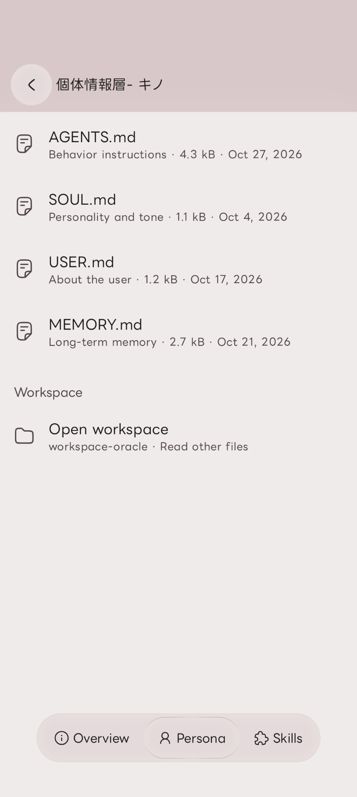
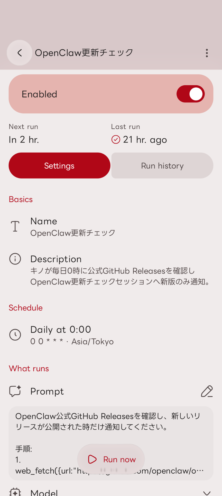

# SumahoClaw

English | [日本語](README.ja.md)

An unofficial Android client for [OpenClaw](https://github.com/openclaw/openclaw), built to make AI coding with OpenClaw comfortable on a phone. The UI is designed around the file tree, file viewer, terminal, and easy parallel development with worktrees.
> This app does not aim to cover all OpenClaw features.

https://github.com/user-attachments/assets/460b1cbb-cf53-4374-a51c-96633a2e692d

## Supported versions

- OpenClaw Gateway: 2026.11.10
- Android 13 or later

## Features

A native app with Material 3 Expressive design.

### Themes

| Theme name | Light | Dark |
| --- | --- | --- |
| OpenClaw |  |  |
| Monochrome |  |  |
| Dynamic (Wallpaper) |  |  |
| Custom |  |  |

### Connection

Enter your Gateway URL and token, then approve the connection. Tailscale is recommended.

  

### Side panel

- Switch between Chat and Dev modes.
- Check Git diffs, branches, and worktrees in Dev mode.
- Quickly switch between up to four agents using tabs.

  
  
  

### Session view

- View session conversations and access features from the session menu.
- Switch models and reasoning effort, and check usage, host memory, and disk space.

  
  

### Files, terminal, and parallel development

- Browse file dates and sizes in the file tree, upload files, and create files and folders.
- View, edit, and delete files in the file viewer.
- Use the terminal.
- Quickly create a worktree with the parallel development button.

  
  
  
  
  

### Agent settings

View agent details, personality, and skills.

  
  
  

### Automations

View, edit, and run automations.

  
  

### Home screen shortcuts

Create and edit shortcuts to agents and sessions for quick access from your home screen.

  
  

## Privacy Policy

[Privacy Policy](docs/privacy-policy.md) (Japanese / English)

## License

[MIT License](LICENSE)

Licenses of the bundled libraries, fonts, and icons are available in the app under Settings → About → Open source licenses. `reference/openclaw/` is a copy of source and documentation from [OpenClaw](https://github.com/openclaw/openclaw), covered by its own MIT License (`reference/openclaw/LICENSE`).
