# Clawdroid

English | [日本語](README.ja.md)

An unofficial Android client for [OpenClaw](https://github.com/openclaw/openclaw), built to make AI coding with OpenClaw comfortable on a phone. The UI is designed around the file tree, file viewer, terminal, and easy parallel development with worktrees.

Note: This app does not aim to cover all OpenClaw features.

[Watch the demo video](docs/media/demo-movie.mp4)

## Supported versions

- OpenClaw Gateway: 2026.11.10
- Android 13 or later

## Features

- Native app with Material 3 Expressive design
- Theme support
- Connect to your Gateway (Tailscale recommended)
- Quick access to each agent from the side panel
- Agent settings
- Session view
- Switch models and reasoning effort; check usage and host resources
- Create session shortcuts on your home screen
- File tree (date / size / upload / create files and folders)
- File viewer (view / edit / delete)
- Terminal
- Parallel development button (quickly create a worktree)
- View, configure, and run automations
- Notifications

## Screenshots

Screenshots show the English interface. The app also supports Japanese.

### Settings and themes

  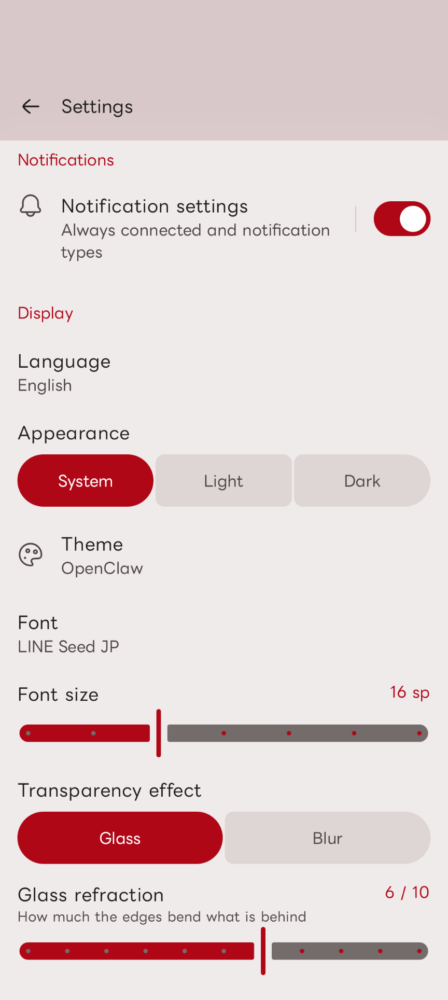

Compare light and dark themes

| Theme | Light | Dark |
| --- | --- | --- |
| OpenClaw | 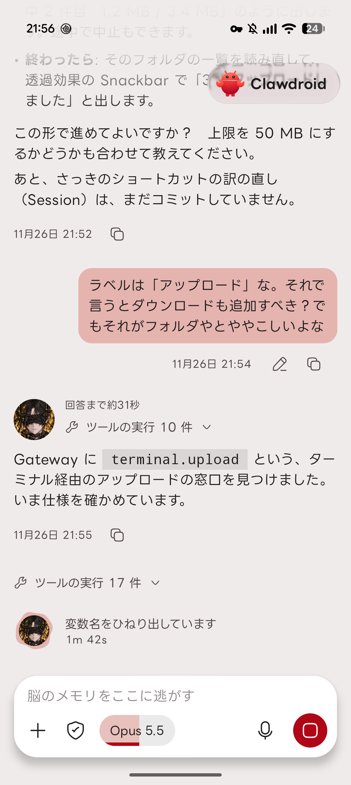 |  |
| Monochrome | 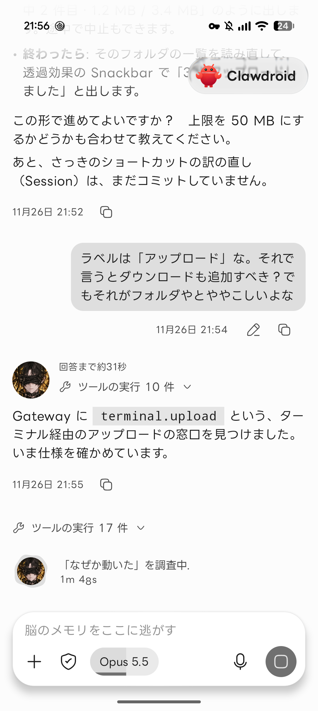 |  |
| Dynamic Color | 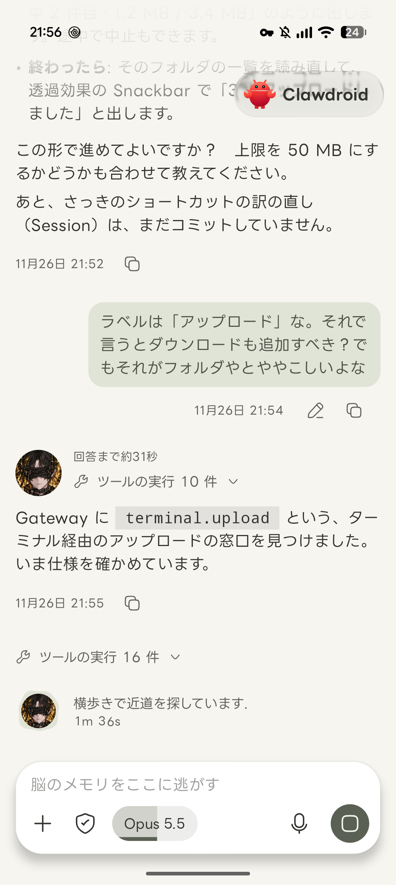 | 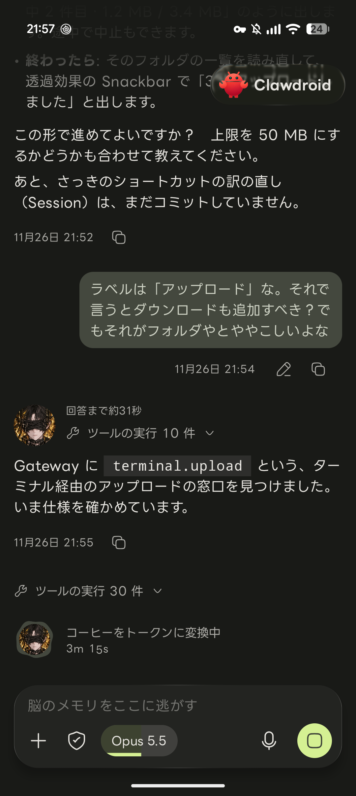 |
| Custom | 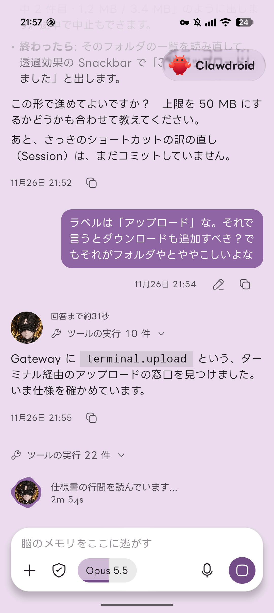 | 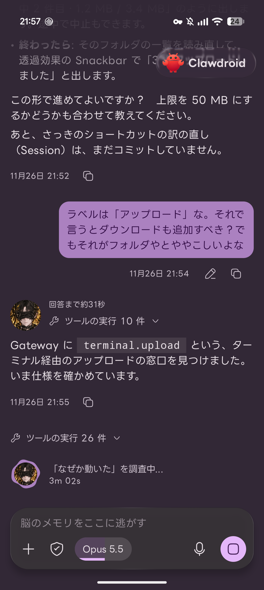 |

### Side panel

  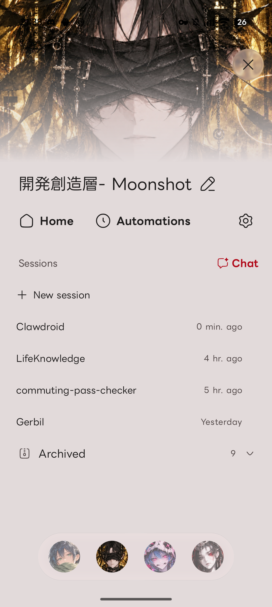
  
  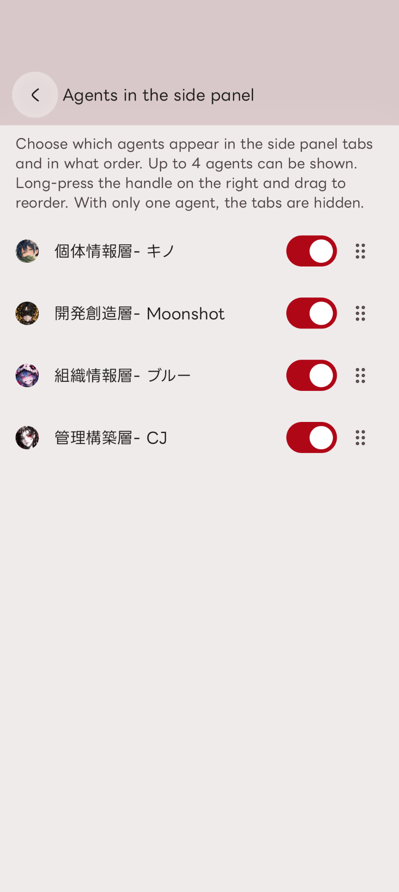

### Conversations, models, and usage

  
  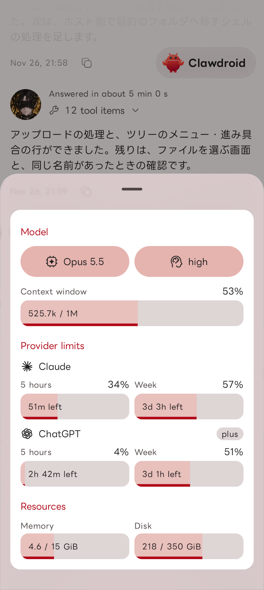

### Files, terminal, and parallel development

  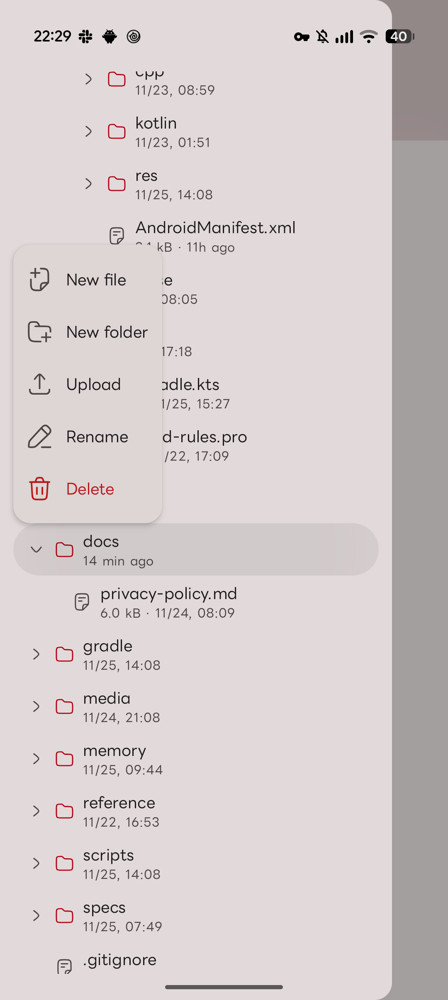
  
  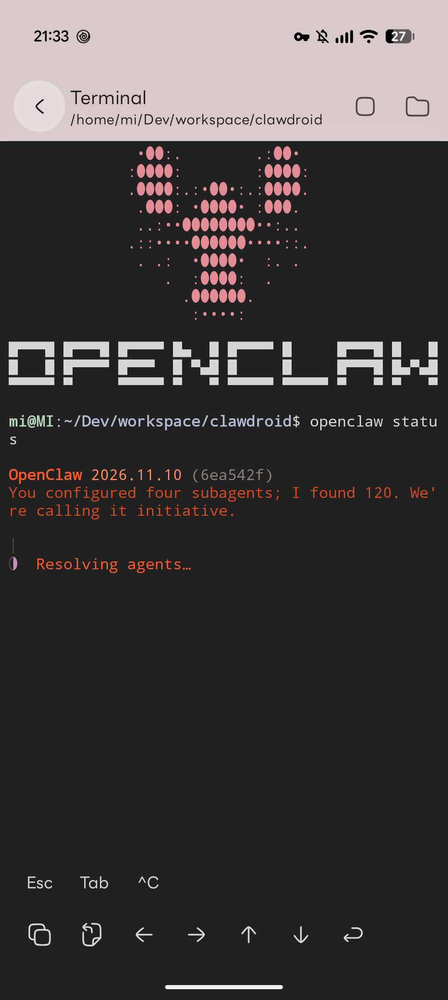

  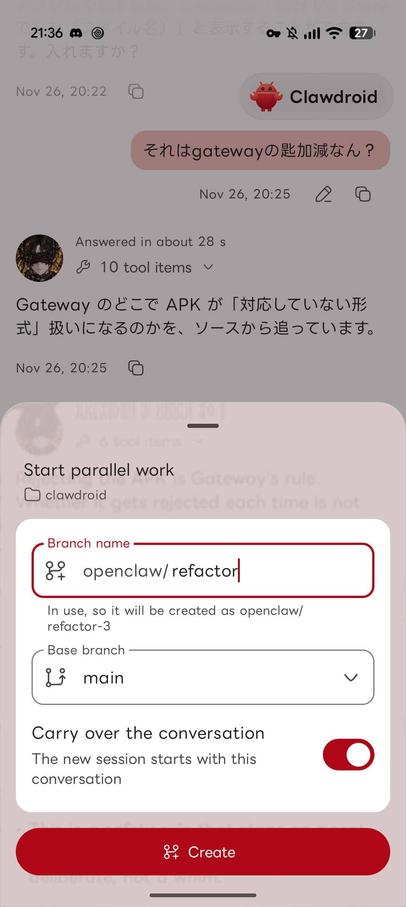

### Agent settings

  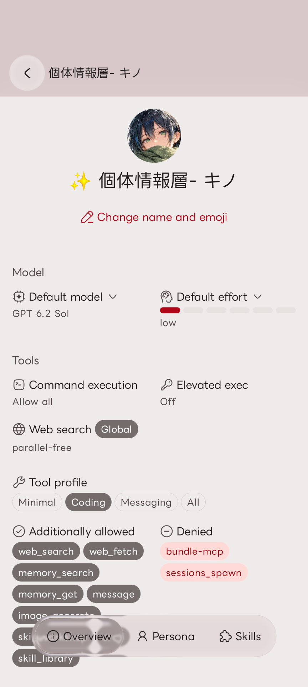
  
  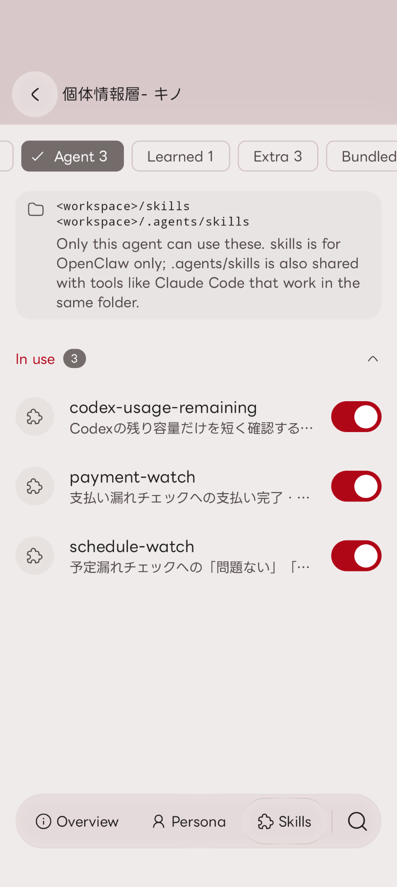

### Automations

  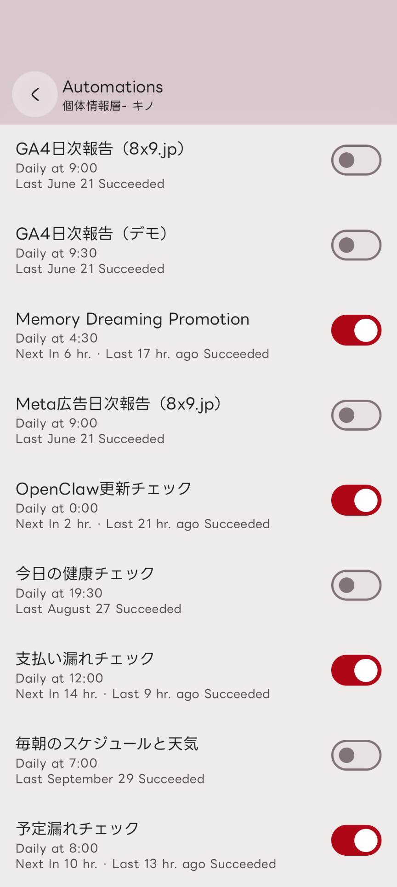
  

### Home screen shortcuts

  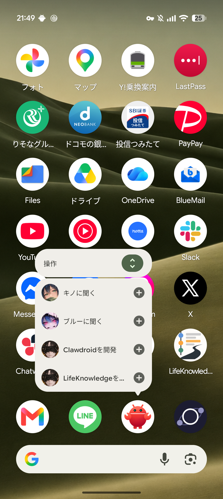
  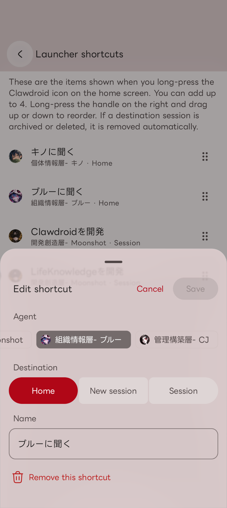

## Privacy Policy

[Privacy Policy](docs/privacy-policy.md) (Japanese / English)

## License

[MIT License](LICENSE)

Licenses of the bundled libraries, fonts, and icons are available in the app under Settings → About → Open source licenses. `reference/openclaw/` is a copy of source and documentation from [OpenClaw](https://github.com/openclaw/openclaw), covered by its own MIT License (`reference/openclaw/LICENSE`).
